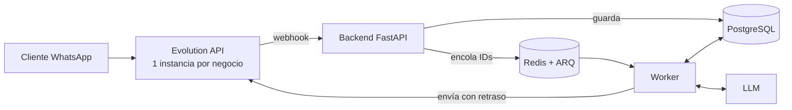

# Asistente IA para WhatsApp — Gestión de citas (SaaS multi-negocio)

Asistente virtual para **negocios que agendan citas** (barberías, consultorios, estudios, etc.) que atiende por WhatsApp, responde preguntas frecuentes **del negocio** y **agenda, cancela y reagenda citas** usando un LLM con *tool calling*. Un solo despliegue atiende a varios negocios (multi-tenant), cada uno con su propio número, servicios, horarios y estilo.

> **Estado:** MVP implementado (Fase 0 y núcleo de Fases 1–2). La consola de Telegram envía avisos; responder desde Telegram y Chatwoot siguen diferidos. Primera vertical: barberías.
>
> **Arranque:** ver [`COMO_ARRANCAR.md`](./COMO_ARRANCAR.md). Comando rápido: `./start.sh`.
> Ver [`ARCHITECTURE.md`](./WTM-Docs/ARCHITECTURE.md), [`DESIGN.md`](./WTM-Docs/DESIGN.md), [`PLAN.md`](./WTM-Docs/PLAN.md) y [`Legal.md`](./WTM-Docs/Legal.md).

---

## Características

- Conversación natural en WhatsApp con el **estilo del negocio** (ejemplos reales de mensajes del dueño) y retraso de respuesta configurable ("escribiendo…").
- **Alcance acotado al negocio:** no es un asistente de propósito general. Se presenta como asistente virtual y responde con honestidad si le preguntan.
- Agenda con **servicios, recursos (barberos/profesionales) y horarios editables**, excepciones (festivos, vacaciones, bloqueos), reservas provisionales y **prevención de doble reserva en la base de datos**.
- **Recordatorios de cita** desde el MVP.
- **Traspaso a humano** por reglas, por intención (LLM) o cuando el dueño responde: el bot se pausa y avisa por la consola activa (app de WhatsApp, Telegram opcional; Chatwoot previsto).
- **Notas de voz** como complemento (transcripción).
- **Planes y complementos** configurables en base de datos (canal, modelo, límites, funciones).
- Idempotencia de webhooks, debounce de mensajes seguidos, lock por cliente y envío idempotente.
- Registro de consumo del LLM/STT por negocio (`llm_usage`).
- Canal desacoplado: Evolution API hoy; API oficial de WhatsApp (o coexistencia) después.
- Respaldos **por número de recepción**, independientes de la sesión de WhatsApp.

## Stack

| Capa | Tecnología |
|---|---|
| Canal WhatsApp | Evolution API (QR) · API oficial después |
| Backend | Python 3.12 + FastAPI + SQLAlchemy (async) + Alembic |
| Cola | **ARQ** sobre Redis (worker separado) |
| Base de datos | PostgreSQL 16 |
| Redis | Dos instancias: caché de Evolution y cola (AOF, `noeviction`) |
| Proxy / HTTPS | Caddy 2 |
| LLM | OpenRouter en pruebas; proveedor final por definir |
| Consola del dueño | App de WhatsApp · Telegram (opcional) · Chatwoot (módulo listo, no desplegado) |
| Despliegue | Docker Compose (WSL en desarrollo, VPS en producción) |

## Cómo fluye un mensaje



1. El webhook valida, filtra, deduplica y **guarda** el mensaje; encola `process_conversation` con unos segundos de espera (debounce).
2. El worker agrupa los mensajes, arma el contexto (prompt activo, estilo, resumen, historial, servicios, hora local) y llama al LLM con herramientas.
3. Los turnos los **decide el código** (`booking_service`): huecos, reserva provisional, confirmación y restricción en Postgres.
4. La respuesta va a la bandeja de salida con envío programado; antes de enviar se revisa que no haya pausa ni mensajes nuevos.

Detalles completos (esquema SQL, cola, Compose, respaldos) en [`ARCHITECTURE.md`](./ARCHITECTURE.md).

---

## Requisitos

- Docker y Docker Compose v2 (en Windows: WSL2 con integración de Docker Desktop).
- Clave de API de OpenRouter u otro proveedor de LLM.
- Un número de WhatsApp **dedicado** para pruebas (staging).
- Para producción: VPS de 4 GB de RAM, dominio y DNS.

## Inicio rápido (desarrollo local)

```bash
# 1. Clonar
git clone <URL_DEL_REPO> wtm
cd wtm

# 2. Variables
cp .env.example .env      # completa contraseñas y claves

# 3. Levantar servicios (postgres, redis x2, evolution-api, backend, worker)
docker compose up -d
#    Caddy es solo para producción y vive en el perfil "production":
#    docker compose --profile production up -d

# 4. Migraciones
docker compose exec backend alembic upgrade head

# 5. Cargar planes y un negocio de prueba
docker compose exec backend python -m scripts.seed_plans
docker compose exec backend python -m scripts.create_business \
  --name "Barbería Demo" --phone 573001234567 --instance demo --plan basic

# 6. Crear la instancia en Evolution API, escanear el QR y apuntar el webhook a
#    http://backend:3000/webhook/demo   (con el secreto del negocio)
```

> Los comandos de `scripts/` son parte del plan del MVP; ajústalos a lo que implementes.

### Variables de entorno (principales)

| Variable | Descripción |
|---|---|
| `POSTGRES_PASSWORD`, `APP_DB_PASSWORD`, `EVOLUTION_DB_PASSWORD` | Contraseñas de Postgres |
| `EVOLUTION_API_KEY` | API key de Evolution API |
| `WEBHOOK_SECRET` | Secreto base para firmar/validar webhooks (se deriva uno por negocio) |
| `ADMIN_TOKEN` | Token del API `/admin` (si está vacío se usa `WEBHOOK_SECRET`) |
| `REDIS_QUEUE_URL` | Redis de la cola (AOF, `noeviction`) |
| `LLM_PROVIDER` / `LLM_API_KEY` / `LLM_MODEL` | Proveedor (p. ej. OpenRouter), clave y modelo |
| `LLM_FALLBACK_MODEL` | Modelo de respaldo (implementado, **apagado** por defecto) |
| `STT_API_KEY` | Transcripción de voz (si se activa el complemento) |
| `TELEGRAM_BOT_TOKEN` | Bot de Telegram (opcional) |
| `BACKUP_*` | Destino y clave de cifrado de respaldos |
| `DOMAIN_API` / `DOMAIN_EVO` | Dominios para Caddy (producción) |

Nunca subas `.env` al repositorio.

---

## Estructura del repositorio

```
.
├── WTM-Back/              # backend FastAPI + worker ARQ
│   ├── src/
│   │   ├── config/        # settings, database, LLM
│   │   ├── api/           # webhook y admin
│   │   ├── channels/      # Evolution, Cloud API (stub)
│   │   ├── consoles/      # whatsapp_app, telegram, chatwoot (módulo listo)
│   │   ├── workers/       # tareas ARQ y cron
│   │   ├── services/      # pipeline, contexto, LLM, agenda, recordatorios, STT
│   │   ├── repositories/  # acceso a datos (siempre con business_id)
│   │   ├── models/
│   │   └── migrations/    # Alembic
│   ├── scripts/           # seed_plans, create_business, ...
│   ├── tests/
│   └── Dockerfile
├── WTM-Front/             # reservado para el panel web (Fase 4)
├── WTM-Docs/              # ARCHITECTURE, DESIGN, PLAN, Legal
├── initdb/                # crea bases y usuarios (evolution, app)
├── Caddyfile
├── docker-compose.yml
├── .env.example
└── README.md
```

---

## Documentación

| Documento | Contenido |
|---|---|
| [`WTM-Docs/ARCHITECTURE.md`](./WTM-Docs/ARCHITECTURE.md) | Topología, multi-tenant, backend, configuración por capas, esquema PostgreSQL, flujo, cola, Compose y respaldos. |
| [`WTM-Docs/DESIGN.md`](./WTM-Docs/DESIGN.md) | Decisiones, reglas de comportamiento (pipeline, retraso, agenda, traspaso, voz), riesgos y fases. |
| [`WTM-Docs/PLAN.md`](./WTM-Docs/PLAN.md) | Planes Básico/Pro/Premium, complementos, márgenes y reglas de implementación. |
| [`WTM-Docs/Legal.md`](./WTM-Docs/Legal.md) | Protección de datos (Colombia), cartel con QR, subencargados, WhatsApp/Meta, contratos y checklist. |

---

## Alta de un nuevo negocio (resumen)

1. Registrar el negocio (número, zona horaria, plan) y su **prompt** (estilo con ejemplos reales de mensajes del dueño).
2. Cargar **servicios, recursos, horarios y excepciones** (editables luego por Telegram/panel).
3. Crear la instancia en Evolution API, vincular el número y configurar el webhook.
4. Configurar **consolas del humano** (app de WhatsApp, Telegram si aplica) y complementos (voz).
5. Firmar el contrato SaaS y el anexo de transmisión de datos; publicar la política de datos.
6. Imprimir el **cartel con QR de WhatsApp (mensaje prellenado)** y colocar el enlace en el perfil.
7. Probar en **staging** (consulta, reserva, cancelación, traspaso, recordatorio, audio si aplica).

## Operación

- **Respaldos:** `pg_dump` diario de `app` y `evolution` + exportación por negocio (`backups/<numero>/<fecha>`), **cifrados** y fuera del VPS; restauración probada.
- **Salud:** `/health`, alerta de instancias desconectadas, mensajes pendientes antiguos y envíos `failed`.
- **Trazabilidad:** `correlation_id` por mensaje en webhook, jobs, LLM y envío.
- **Seguridad:** solo Caddy expone puertos; webhook con secreto; aislamiento por `business_id`.
- **Costos:** revisar `llm_usage` semanalmente.

## Consideraciones legales (resumen)

El negocio es *Responsable* de los datos y este servicio es *Encargado*: se requiere contrato de transmisión, aviso de tratamiento (cartel con QR y respaldo en el primer contacto) y política de retención. El uso de Evolution por QR **no es un canal oficial de WhatsApp** y conlleva riesgo de bloqueo. El asistente se presenta como virtual y no finge ser una persona. Lee [`Legal.md`](./Legal.md) antes de vender. Este README no es asesoría legal.

## Pruebas

```bash
docker compose exec backend pytest
```

Prioridades: idempotencia de webhooks y de envío, doble reserva y reservas provisionales, zonas horarias, aislamiento entre negocios, recordatorios, herramientas del LLM con parámetros inválidos y simulador de conversaciones con canal falso.

## Hoja de ruta

- [x] **Fase 0:** entorno Docker, migraciones, canal falso.
- [x] **Fase 1:** webhook, bandejas, worker, LLM con herramientas, agenda (servicios/recursos/horarios), recordatorios, `llm_usage`, prompts versionados.
- [x] **Fase 2:** debounce y locks, cancelar/reagendar, traspaso (app + avisos Telegram), excepciones editables, resumen, voz, Caddy, respaldos por número.
- [ ] **Fase 3:** producción con 3 a 7 negocios, staging aprobado, panel/Telegram de administración (responder desde Telegram).
- [ ] **Fase 4:** API oficial/coexistencia (Premium), baja de clientes, refinar condición de carrera del traspaso, modelo de respaldo operativo, Chatwoot si se requiere.

**Diferido a propósito:** baja de clientes (BAJA), condición de carrera del traspaso, puente Telegram ↔ Evolution, Chatwoot (módulo listo, no desplegado), modelo de respaldo (implementado, apagado) y app de administración.

## Contribuir

1. Rama desde `main`: `git checkout -b feature/nombre`.
2. Cambios de esquema **solo** con migraciones Alembic.
3. Toda consulta filtra por `business_id`; añade pruebas de aislamiento cuando toques repositorios.
4. Añade pruebas para la lógica nueva.
5. En el pull request, indica el impacto en datos personales si lo hay.

## Licencia

Por definir. Hasta decidirla, todos los derechos están reservados. Revisa las licencias de Evolution API y n8n antes de redistribuir o incluirlos en un producto comercial (ver `Legal.md`).
